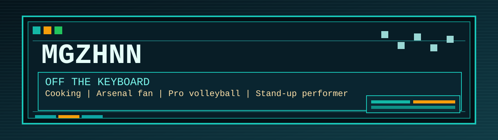

  

<h1 align="center">Magzhan Ziyabek</h1>

  <code>Applied AI</code>
  <code>Digital Logic</code>
  <code>Systems</code>

  
  

## Current Focus
- Applied AI
- Grasp-Intention Inference for Bimanual Soft Gloves — head-mounted RGB-D perception (DGIST SAIL)
- Continual Learning — catastrophic forgetting in CNNs vs. Vision Transformers (DGIST UGRP)
- Diffusion Models for Medical Anomaly Detection
- Digital Logic Design and Hardware Architecture

## Tech Stack

  <strong>Python / AI</strong> 
  
  
  
  
  

  <strong>Systems</strong> 
  
  
  
  

  <strong>Hardware</strong> 
  
  
  
  

  <strong>Web and Tools</strong> 
  
  

## Featured Projects
| Project | Description |
| --- | --- |
| [lineageguard](https://github.com/Mgzhnn/lineageguard) | Reliability control plane for AI agent handoffs in TypeScript: finds the first broken handoff, blocks unapproved tools and prepares the smallest safe retry. [Live site](https://lineageguard.ugrp44group.chatgpt.site) · [npm](https://www.npmjs.com/package/lineageguard) |
| [verilog-16-bit-cpu-design](https://github.com/Mgzhnn/verilog-16-bit-cpu-design) | 16-bit CPU design in Verilog with register file, ALU, decoder, program counter, memory interface, and ModelSim testbenches. |
| [Low-Level-Calculator](https://github.com/Mgzhnn/Low-Level-Calculator) | 4-bit signed calculator in VHDL with add/sub/mul/div, Euclidean division adjustment, and seven-segment display pipeline. |
| [THOR_DDPM_IDRiD](https://github.com/Mgzhnn/THOR_DDPM_IDRiD) | Adaptation of THOR_DDPM for diffusion-based anomaly detection on retinal fundus images. |
| [it-ml](https://github.com/Mgzhnn/it-ml) | Chapter-by-chapter practice notebooks based on hands-on ML material. |
| [OOP-Project---ATM-Machine](https://github.com/Mgzhnn/OOP-Project---ATM-Machine) | Console ATM simulation in C++ with multi-bank, bilingual flow, and transaction history features. |
